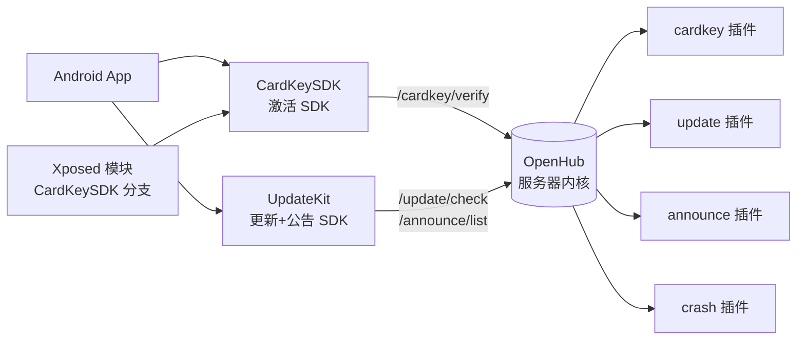

# CardKey 生态总览 · 三仓库关系与接入路线

> 本文是三个仓库的**地图**：它们各自解决什么、彼此怎么连、按什么顺序接。
> 各仓库细节看各自的 README；本文只讲"关系"和"路线"。

[中文](#中文) | [English](#english)

## 一、三个仓库，一条主线

主线：**客户端 SDK（App 里）→ OpenHub（服务器）→ 插件业务**。内核写一次，加一个客户端 = 加一个插件。

| 仓库 | 角色 | 装在哪 | 解决什么 |
|---|---|---|---|
| [CardKeySDK](https://github.com/wanwu2026/CardKeySDK) | 客户端 SDK（激活） | Android App / Xposed 模块 | 卡密激活、设备绑定、防篡改，开启付费功能 |
| [OpenHub](https://github.com/wanwu2026/OpenHub)（本仓库） | 通用后端平台 | 服务器（Docker / 裸机一键部署） | 发卡、验卡、更新清单、公告、崩溃上报、鉴权、审计 |
| [UpdateKit](https://github.com/wanwu2026/UpdateKit) | 客户端 SDK（更新+公告） | Android App | 安全查更新（签名+指纹双校验）、拉签名公告 |

一句话记忆：**CardKey 管"能不能用"，UpdateKit 管"有没有新版/新公告"，OpenHub 是它们背后的服务器。**

## 二、关系图

## 三、插件 ↔ SDK 对应表（谁调谁）

| OpenHub 插件 | 服务端路由 | 对应客户端 | 客户端做的事 |
|---|---|---|---|
| `cardkey` | `POST /api/v1/cardkey/verify`（扁平兼容） | CardKeySDK | 本地验签 + 设备绑定 + 有效期 |
| `update` | `GET /api/v1/update/check`、`/manifest/{product}` | UpdateKit | 验清单签名 → 下载 APK 比对签名证书 SHA-256（双校验） |
| `announce` | `GET /api/v1/announce/list` | UpdateKit | 逐条验签，失败丢弃；按 published_at 水位增量拉取 |
| `crash` | `POST /api/v1/crash/report` | 暂无专用 SDK（预留） | 上报前 App 自行脱敏；服务端再脱敏+限流 |

内核通用接口（不属任何插件）：`GET /core/health`、`POST /core/keys`、`GET /core/audit`。

## 四、统一约定（三仓库共同遵守）

1. **鉴权**：客户端带 `Authorization: Bearer <API Key>`；管理接口带 Admin Token（同格式）。API Key 在客户端里**不是保密凭据**——安全来自验签，不来自藏 Key。
2. **响应包络**：统一 `{ok, data, meta}`（唯一例外：CardKey 的 `/verify` 返回扁平 `{ok, license}`，为兼容已发布的 SDK，已在契约 §8 登记）。
3. **签名**：RSA-2048 / SHA-256，签名 Base32 编码（RFC4648 无填充）。规范 JSON = `json.dumps(obj, sort_keys=True, separators=(',',':'))`（`ensure_ascii=True`）。**客户端必须用同参重建字节，否则中文内容验签失败**——这是三个 SDK 最容易踩的坑。
4. **私钥只在服务器**：`OPENHUB_CARDKEY_PRIVATE_KEY` / `OPENHUB_UPDATE_PRIVATE_KEY`。客户端只嵌公钥。

## 五、接入路线（按你要做什么）

### 场景 A：App 要"付费激活"
1. 服务器：一键部署 OpenHub（`deploy/install.sh`），管理员生成 API Key + 用签发工具发卡。
2. App：接入 CardKeySDK（`implementation project(':sdk')`），`Application.onCreate` 初始化公钥与产品号，激活界面弹 `ActivationDialog`，业务判断 `isActivated()`。
3. 验卡走 OpenHub `cardkey` 插件；详情见 CardKeySDK README。

### 场景 B：App 要"检查更新 + 弹公告"
1. 服务器：OpenHub `update` 插件 `POST /publish` 发版本清单（含 apk_url、sha256、**signer_fingerprint**）；`announce` 插件 `POST /publish` 发公告。
2. App：接入 UpdateKit，`checkUpdate()` 查更新、`fetchNotices()` 拉公告；**下载 APK 后必须做第二道指纹比对**（`Fingerprint.archiveApp` vs `manifest.signer_fingerprint`）。
3. 详情见 UpdateKit README + 本文第六节的契约索引。

### 场景 C：全套（激活 + 更新 + 公告 + 崩溃）
按 A、B 分别接；崩溃上报目前服务端 `crash` 插件已就绪，客户端可直接 POST `/api/v1/crash/report`（尚未封装专用 SDK，可自行封装或贡献一个）。

## 六、分支 / 版本说明

- **CardKeySDK**：`normal-android-app`（默认，普通 App 接入）、`xposed-injection-module`（XP 注入式模块，Target Package 占位待填）、`demo-backend`（早期独立后端，功能已并入 OpenHub，仅作历史参考）。
- **OpenHub**：`main`（默认）。
- **UpdateKit**：`main`（默认）。

## 七、索引（深入某个点看这里）

| 想了解 | 去哪 |
|---|---|
| 后端接口全约定 | OpenHub `docs/API_CONTRACT.md`（§7.x 各插件、§8 兼容例外） |
| 后端架构与目录 | OpenHub `docs/ARCHITECTURE.md` |
| 更新/公告签名细节 | UpdateKit `docs/API_CONTRACT.md` |
| 卡密格式与签发 | CardKeySDK `docs/keygen.md`、`docs/backend.md` |
| 一键部署 | OpenHub `deploy/install.sh`（docker / bare 两种模式） |

---

## Ecosystem Overview — Three Repositories, One Thread

> This is a **map**: what each repo does, how they connect, and in what order to adopt them.
> For details see each repo's README; this document covers only relationships and the route.

| Repo | Role | Runs on | Solves |
|---|---|---|---|
| [CardKeySDK](https://github.com/wanwu2026/CardKeySDK) | Client SDK (activation) | Android app / Xposed module | License activation, device binding, tamper resistance |
| [OpenHub](https://github.com/wanwu2026/OpenHub) (this repo) | Generic backend platform | Server (Docker / bare one-click) | Issuing/verifying licenses, updates, announcements, crash reports, auth, audit |
| [UpdateKit](https://github.com/wanwu2026/UpdateKit) | Client SDK (update + notices) | Android app | Safe update checks (signature + fingerprint double-check), signed notices |

In one line: **CardKey = "may I use it", UpdateKit = "is there a new version / announcement", OpenHub = the server behind both.**

### Plugin ↔ SDK map

| OpenHub plugin | Routes | Client | Client work |
|---|---|---|---|
| `cardkey` | `POST /api/v1/cardkey/verify` (flat) | CardKeySDK | local signature verify + device binding + expiry |
| `update` | `GET /api/v1/update/check`, `/manifest/{product}` | UpdateKit | verify manifest signature → compare APK cert SHA-256 (double-check) |
| `announce` | `GET /api/v1/announce/list` | UpdateKit | verify each notice, drop failures; incremental by published_at |
| `crash` | `POST /api/v1/crash/report` | none yet (reserved) | client redacts before posting; server redacts + rate-limits |

### Shared contracts

1. **Auth**: clients send `Authorization: Bearer <API Key>`; admin routes use an Admin Token (same form). An API Key in a client is **not a secret** — security comes from signature verification, not hiding the Key.
2. **Envelope**: `{ok, data, meta}` everywhere (one exception: CardKey `/verify` returns flat `{ok, license}` for compatibility, registered in contract §8).
3. **Signing**: RSA-2048 / SHA-256, Base32-encoded (RFC4648, no padding). Canonical JSON = `json.dumps(obj, sort_keys=True, separators=(',',':'))` (`ensure_ascii=True`). **Clients must rebuild bytes identically or non-ASCII content fails verification** — the most common pitfall across all SDKs.
4. **Private keys stay server-side** (`OPENHUB_CARDKEY_PRIVATE_KEY` / `OPENHUB_UPDATE_PRIVATE_KEY`); clients embed only the public key.

### Adoption routes

- **Paid activation**: deploy OpenHub → create API Key + issue licenses → integrate CardKeySDK → gate features with `isActivated()`.
- **Update + announcements**: publish a signed manifest (`update/publish`, including **signer_fingerprint**) and notices (`announce/publish`) → integrate UpdateKit → **always do the post-download fingerprint check**.
- **Everything**: combine both; `crash` plugin is server-ready, no dedicated client SDK yet (contribute one or POST directly).

### Branches

- CardKeySDK: `normal-android-app` (default), `xposed-injection-module` (Xposed, TARGET_PACKAGE placeholder), `demo-backend` (early standalone backend, historical only).
- OpenHub / UpdateKit: `main` (default).

### Index

| Topic | Where |
|---|---|
| Full backend contract | OpenHub `docs/API_CONTRACT.md` (§7.x plugins, §8 compatibility) |
| Backend architecture | OpenHub `docs/ARCHITECTURE.md` |
| Update/notice signing | UpdateKit `docs/API_CONTRACT.md` |
| License format + issuing | CardKeySDK `docs/keygen.md`, `docs/backend.md` |
| One-click deploy | OpenHub `deploy/install.sh` (docker / bare) |
